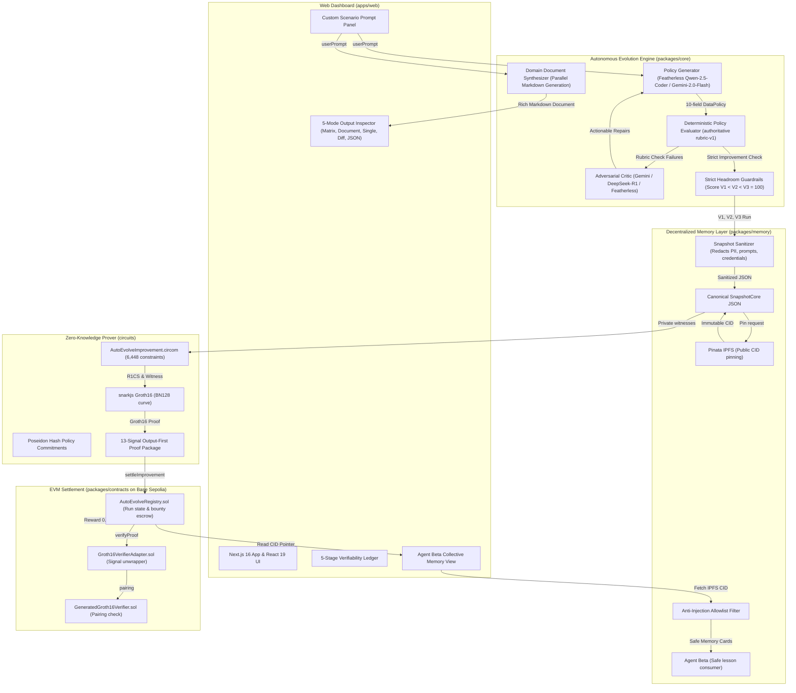

# AutoEvolve Protocol — System Architecture

AutoEvolve is an open-source framework and verification protocol for **bounded self-improving AI agents**. It transforms unverified LLM claims of "self-improvement" into mathematically verifiable, cryptographically bound evidence settled on a public blockchain.

---

## 1. High-Level Architecture Overview

---

## 2. Core Subsystems

### A. Dual-Track Multi-Model Execution Engine

The engine decouples **ZK Arithmetic Constraints** from **Domain Deliverables**:

1. **Arithmetic Policy Track (Circom Bounds)**:
   - Evaluates exactly 10 deterministic security and governance fields.
   - Strict bitwidth constraints ensure mathematical compatibility with Circom circuits (`dailyRequestLimit <= 127`, `retentionDays <= 63`, `maxExportRows <= 16383`, `minKAnonymity <= 255`).
   - Clamped at runtime to prevent out-of-bounds LLM integers from crashing schema validation while accurately recording rubric failures.
2. **Written Solution Document Track (Parallel Generation)**:
   - An LLM (Qwen-2.5-Coder on Featherless or Gemini-2.0-Flash) generates an authentic, structured Markdown solution (e.g. study roadmaps, distributed system blueprints, security playbooks) directly answering the user prompt.
   - Executed concurrently with policy generation via `Promise.all` with zero added latency.
   - If offline or during fallback, the domain-aware synthesizer (`synthesizeDefaultSolutionDocument`) detects the scenario domain and produces a structured, multi-phase document ($V1 \rightarrow V2 \rightarrow V3$).

### B. Adversarial Generator-Critic Separation

To prevent self-congratulatory scoring loops, AutoEvolve enforces architectural separation between the **Generator** and the **Auditor**:

- **Generator**: Generates candidate policies and written deliverables (e.g. Qwen-2.5-Coder-32B or Gemini-2.0-Flash).
- **Adversarial Critic**: Reviews the generated document and candidate policy strictly against failed rubric checks and the user's objective (e.g. Gemini-2.0-Flash or DeepSeek-R1-Distill-Qwen-32B).
- **Authoritative Evaluator**: Purely deterministic TypeScript rubric (`evaluatePolicy`). The LLM critic guides repair strategies, but has zero influence on the numerical score.

### C. Zero-Knowledge Circuit (`AutoEvolveImprovement.circom`)

- **Proves**: That two private policy candidates, committed via Poseidon hashes, satisfy:
  $$\text{Score}(V_{n+1}) > \text{Score}(V_n)$$
  under the exact same versioned rubric rules.
- **Constraints**: 6,448 R1CS constraints, 6,441 wires, 311 template instances.
- **Signal Structure**: 13 output-first public signals (Index 0: `previousScore`, Index 1: `nextScore`, Index 2: `binding`, followed by public inputs).
- **Zero Knowledge**: Private policy fields and internal reasoning remain completely private; only the mathematical improvement and metadata bindings are published.

### D. Sanitized Decentralized Memory & Anti-Injection Guardrails

- **Payload Redaction**: Raw prompts, system instructions, and credentials are wiped before serialization into `SnapshotCore`.
- **Integrity Check**: The on-chain registry records `keccak256(bytes(cid))` to prevent IPFS content tampering.
- **Allowlisted Ingestion**: Agent Beta never ingests raw strings or untrusted markdown from memory. It only ingests typed `failureCode` enum values and allowlisted `safePatchStrategy` recommendations, rendering prompt injection attacks completely inert.

### E. Smart Contracts on Base Sepolia

- **`GeneratedGroth16Verifier.sol`**: Auto-generated from snarkjs; performs BN128 elliptic curve pairing checks (`0x7c32dcfcaaae6bdcc6f5d2daa61b7e91629aa764`).
- **`Groth16VerifierAdapter.sol`**: Translates the 13-signal output-first array into typed call parameters (`0xd46ee3e820d12e113af3e6ad7b6867e18d560c37`).
- **`AutoEvolveRegistry.sol`**: Holds the escrow bounty pool, enforces run state transitions, validates proofs, emits settlement receipts, and records verified memory pointers (`0x24473c0043b13d56874d10de9675728e2014a66c`).

---

## 3. Cryptographic Trust Boundary

| Aspect               | What Is Mathematically Proven                                                             | What Is NOT Proven                                                                          |
| -------------------- | ----------------------------------------------------------------------------------------- | ------------------------------------------------------------------------------------------- |
| **Policy Evolution** | That Version $N+1$ achieved a higher score than Version $N$ under a deterministic rubric. | That the model's internal reasoning or chain-of-thought was truthful or hallucination-free. |
| **Commitments**      | Poseidon hashes cryptographically bind the private policy fields to the public proof.     | That public text stored on IPFS is confidential or non-public.                              |
| **Settlement**       | That an on-chain smart contract verified the Groth16 proof and released a micro-reward.   | That the agent's real-world actions outside the circuit bounds were verified.               |
| **Memory**           | That the IPFS CID hash matches the on-chain pointer and conforms to `SnapshotCore`.       | That untrusted external data sources are inherently safe without allowlist filters.         |
